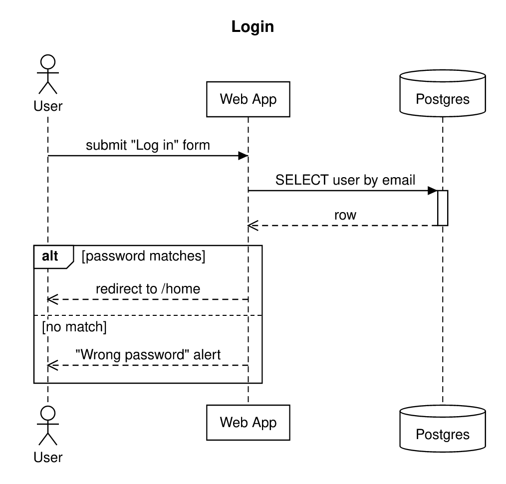

# uml-sequence

An agent skill that draws black-and-white UML sequence diagrams. The agent writes a `.puml` file in a small PlantUML subset, and the bundled renderer turns it into a PNG, an SVG or a standalone HTML page.



The renderer owns the style: dashed lifelines, labels on a white backing, and columns that widen until every label fits. Every diagram comes out the same way, so you never tune the look by hand.

## Install

Needs Node 22.18 or later. No system libraries are required; PNGs are rasterized by `@resvg/resvg-js`.

```sh
git clone https://github.com/xyberr81/uml-sequence ~/.claude/skills/uml-sequence
cd ~/.claude/skills/uml-sequence && npm install
```

Then ask Claude Code to draw a sequence diagram. [SKILL.md](SKILL.md) holds the steps the agent follows and the supported syntax.

Step 2 of the skill calls a `humanizer` skill to clean up label wording. Without it, the agent skips that step.

## Use the renderer directly

```sh
node src/cli.ts login.puml            # writes login.png
node src/cli.ts login.puml login.svg
node src/cli.ts login.puml login.html
```

It prints a `warning:` for each line it couldn't draw and skips that line. It exits 2 on bad usage, 1 on an error, and 0 otherwise.

```puml
title Login
actor User
participant "Web App" as Web
database "Postgres" as DB
User -> Web : submit "Log in" form
Web -> DB ++ : SELECT user by email
DB --> Web -- : row
alt password matches
  Web --> User : redirect to /home
else no match
  Web --> User : "Wrong password" alert
end
```

## Develop

```sh
npm test            # every fixture must match its golden SVG, HTML and warnings
npm run typecheck
```

The goldens started as the output of the original Rust renderer, which this TypeScript version replaced. To change the look on purpose, edit `src/render.ts`, run `test/gen-golden.sh`, and review the golden diff.

## License

[MIT](LICENSE)
