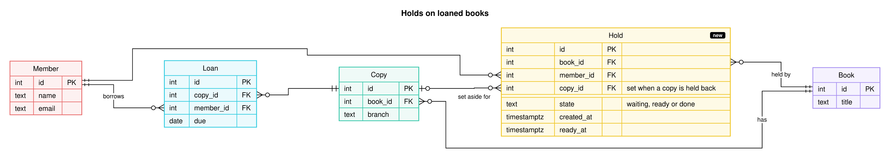

# data-model

An agent skill that draws database schema diagrams (physical data models): tables with column types and keys, joined by crow's-foot relations. It does not draw conceptual Chen-notation ER diagrams. The agent writes a `.puml` file in a small PlantUML subset, and the bundled renderer turns it into a PNG, an SVG or a standalone HTML page.



The renderer owns the style and layout. Each table is a grid of type, name, key and note in its own light colour, tables run left to right, and relation lines meet each table at the row they join. It also draws a schema change: new tables and columns get a `new` badge, deleted ones are dashed, and a retyped column reads `old → new`. Every diagram comes out the same way, so you never tune the look by hand.

## Install

Needs Node 22.18 or later. No system libraries are required; PNGs are rasterized by `@resvg/resvg-js`.

```sh
git clone https://github.com/xyberr81/skills ~/skills
ln -s ~/skills/skills/data-model ~/.claude/skills/data-model
cd ~/.claude/skills/data-model && npm install
```

The skill's steps call the renderer at `~/.claude/skills/data-model/`, so keep that path.

Then ask Claude Code to draw a data model or database schema. [SKILL.md](SKILL.md) holds the steps the agent follows and the supported syntax.

Step 2 of the skill calls a `humanizer` skill to clean up label wording. Without it, the agent skips that step.

## Use the renderer directly

```sh
node src/cli.ts model.puml            # writes model.png
node src/cli.ts model.puml model.svg
node src/cli.ts model.puml model.html
```

It prints a `warning:` for each line it couldn't draw and skips that line. It exits 2 on bad usage, 1 on an error, and 0 otherwise.

```puml
title Holds
entity Copy {
  * id : int
  book_id : int <<FK>>
  shelf : text <<deleted>>
  due : date -> timestamptz
}
entity Hold <<new>> {
  * id : int
  copy_id : int <<FK>> // set when a copy is held back
}
Copy::id |o--o{ Hold::copy_id : set aside for
```

## Develop

```sh
npm test            # layout checks, plus every fixture against its golden SVG, HTML and warnings
npm run typecheck
```

The renderer was split out of ratchet's `render er`, and the goldens started as its output. To change the look on purpose, edit `src/render.ts`, run `test/gen-golden.sh`, and review the golden diff.

## License

[MIT](../../LICENSE)
